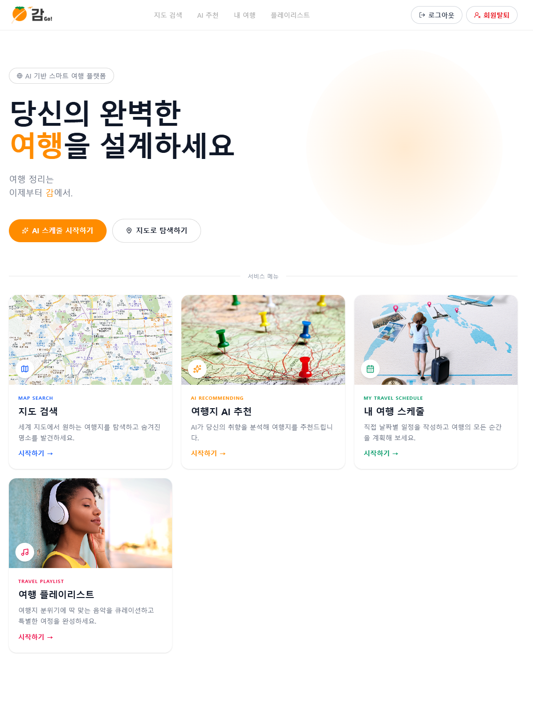
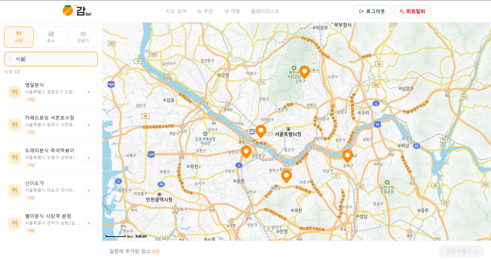
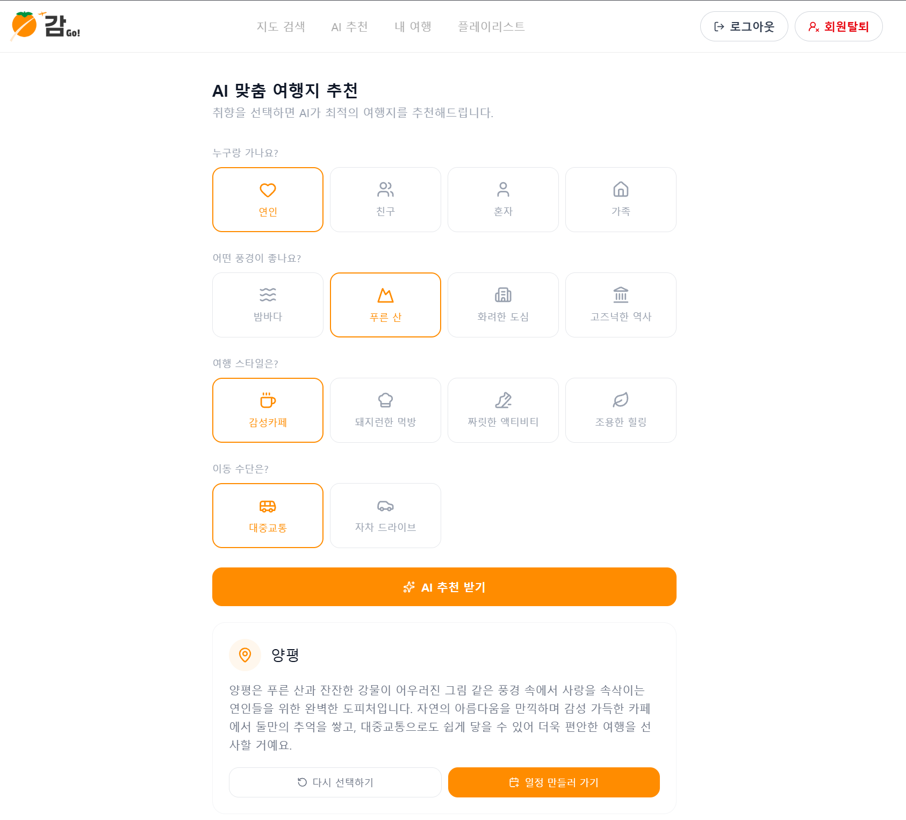
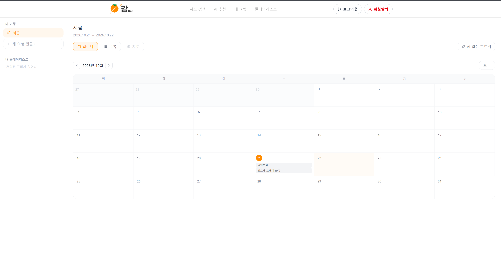
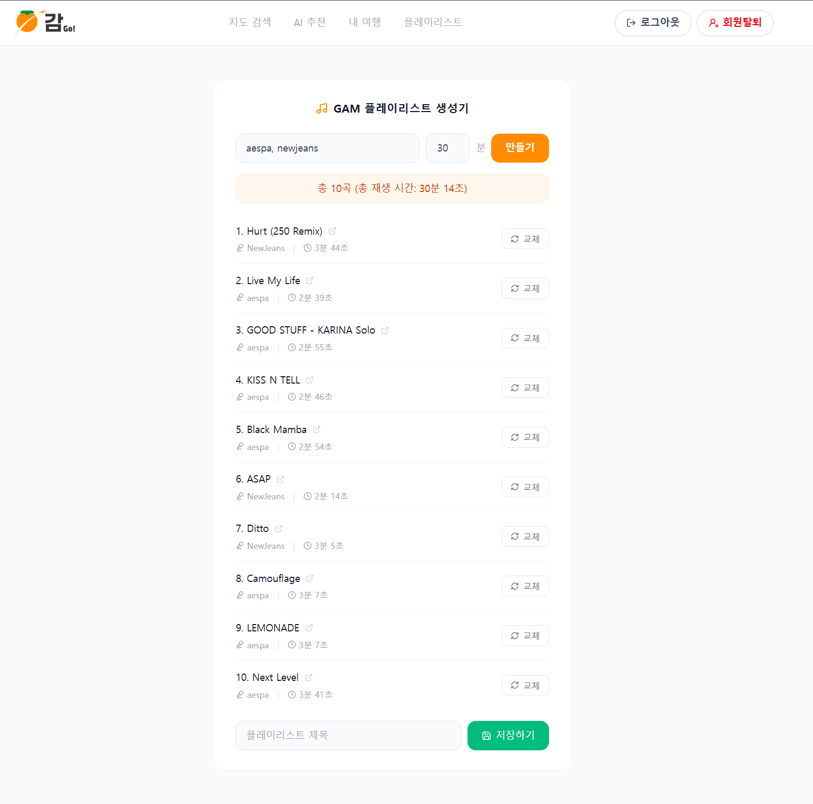

# 감(go!)

AI기반 여행 일정 편성 플랫폼

## 💡 기획 배경

기존의 방식은 여행지 추천, 여행지 검색, 여행 스케줄 편성이 각각 다른 플랫폼들에게서 이루어지는 번거로움을 개선하고자 기획했습니다.

여행지 검색, 여행지 추천, 여행 스케줄 편성은 물론 여행 길에 들을 플레이리스트 제공과 여행길 경로 안내의 기능을 구현했습니다.

## 🚀 주요 기능

- 메인 화면

  

  - 페이지 이동
  - 로그아웃 & 회원탈퇴 기능
 
- 여행지 검색

  

  - 지역 내 식당 & 숙소 & 관광지 검색
  - 검색한 여행지는 내 여행 스케줄에 추가 가능
 
- AI 여행지 추천

  

  - 취향을 선택하면 AI가 여행지를 추천
  - 다시 여행지를 추천 받을 수 있다
 
- 마이페이지

  

  - 내 여행 & 플레이리스트 확인 가능
  - 일정을 더 알차게 AI가 피드백 가능
  - 여행길 경로 알려주는 기능
 
- 플레이리스트 제공

  

  - 가수 이름을 입력하고 시간을 설정하면 AI가 플레이리스트 제작
  - 곡 교체 기능
  - 플레이리스트 저장 기능

## 🛠️ 기술 스택

  - FrontEnd
    
    
    
    
    

  - Development Tool

    
    
    
